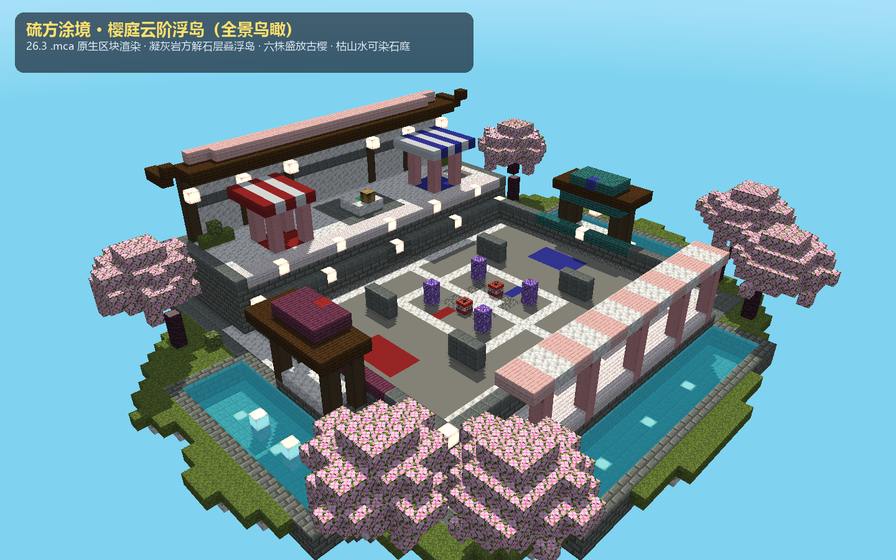
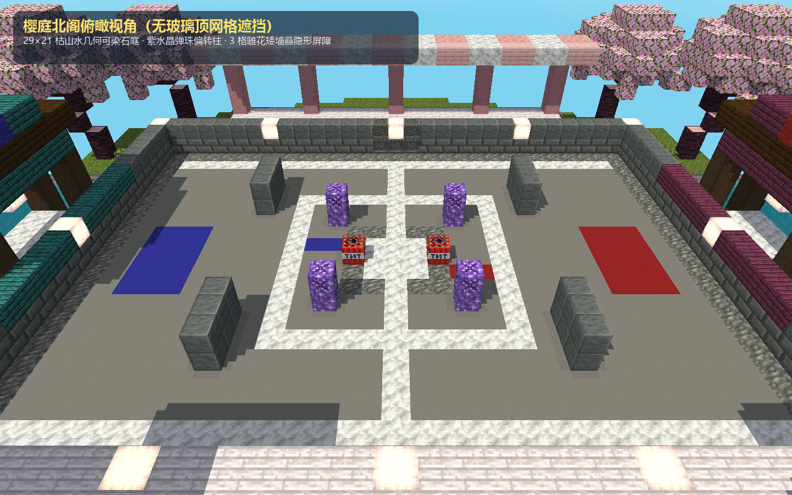
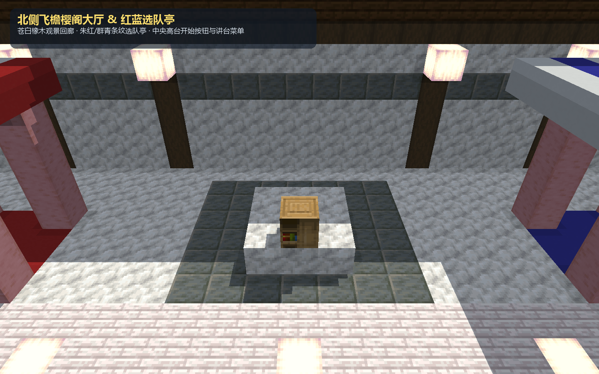

# 硫方涂境（Sulfur Dodge）

基于 **Minecraft Java Edition 26.3**（`pack_format` `121.0`）打造的双队物理弹射 × 枯山水石庭泼墨染色 × 生存淘汰对抗小游戏。两队在樱庭云阶露天石庭中自由游走，使用 **26.3 长矛（Spear + Lunge 突进）**操控高弹低摩擦的**含 TNT 硫方怪（Sulfur Cube）**抢涂领地、引爆歼敌。



| 枯山水可染石庭 | 北侧飞檐樱阁大厅与中央高台 |
| :---: | :---: |
|  |  |

---

## 核心玩法

- **双槽长矛解耦 + 可放置泥砖墙**
  - **1 号位 · 击球长矛**：原地稳定控球。左键轻刺将未点燃白球染为己方色、点燃 **5 秒引信**并刷出 1 格宽色带（对己方燃球接力续时 `+1 秒`，对已点燃白球/敌球仅拨向不改色）；右键架矛在闭合速度达标（默认 `6 格/秒`）时强行夺色反抽为 **3 格宽重炮球**。
  - **2 号位 · 突进短矛（`[突进 II]`）**：消耗体力左键突进，顺势将前方己方燃球平射为**触爆球**（撞墙、障碍或敌方身体即刻引爆）；按住右键在面前架设 **4 格视野引力场**拉弯球路。
  - **3 号位 · 泥砖掩体墙**：东西补给点定期刷新，右键地面筑起两段耐久泥砖墙（普通球撞两下碎，重炮球或爆炸一下即破）。
- **对称预警发球 & 受控泼墨爆破**
  - 南北侧墙发球口提前 `1 秒` 预警并以 `15°～50°` 随机斜角射入；白色中立态滑行期间绝不覆盖或擦除原有地板颜色。
  - 引信归零时触发 **3.5 格圆域泼墨爆破**：红蓝球刷上本队颜色并按模式炸伤/击飞敌方；**白球连锁爆炸**则无差别震伤双方并将圆域洗回安全的中立浅灰地板。
- **异色地板灼烧 & 终局四壁缩圈**
  - 踏入敌方颜色地板超过安全时间（默认 `0.25 秒`，防连跳重置）后持续受到灼烧扣血，单局内关闭自然回血。
  - **限时模式**（默认 `90 秒`）最后 `30 秒` 启动四面高弹外墙逐步向内推进缩圈，全歼即胜、超时按存活四壁内的领地格数判胜；亦可在讲台切换为不缩圈、仅看全歼的**无尽模式**。

---

## 部署与构建

地图进入世界即可直接在大厅选队开局，无需手动初始化。项目构建、客户端部署、打包与无头测试依赖 **[ICMCL/mcbeef](https://github.com/ICMCL/mcbeef)**：

```bash
mcbeef deploy    # 部署至本地客户端 saves/（加 --overwrite-map 同步覆盖地图区块）
mcbeef package   # 导出可独立分发的完整地图存档包 dist/*.zip
mcbeef build     # 重新生成世界区块与 previews/ 预览图
mcbeef test      # 运行 Minecraft 26.3 原版无头 GameTest
```

### 常用调试命令

- `/function sc:menu` — 打开比赛规则设置面板
- `/function sc:admin/force_start` — 单人或人数不足时强制开局调试
- `/function sc:admin/stop` — 强制结束当前对局并返回大厅
- `/function sc:install` — 手动重置大厅实体、计分板与石庭内场

完整数值与机制设计详见 [DESIGN.md](./DESIGN.md)。
